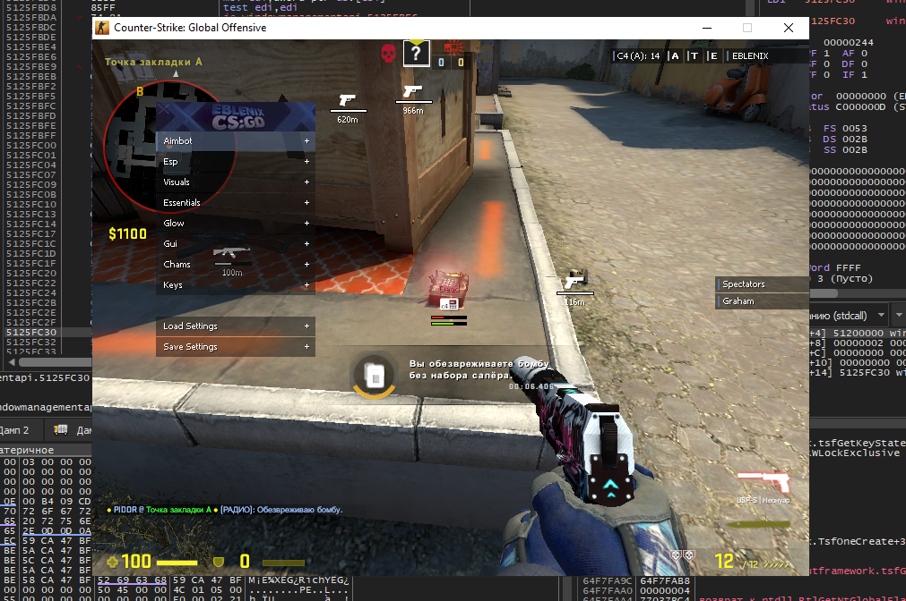

# eblenix_csgo_public
A hack for counter-strike global offensive, created solely for educational purposes in the process of learning gamehacking, which I sometimes used while playing csgo.



# How to use
Clone the repository
```
git clone https://github.com/xastrix/eblenix_csgo_public
```
Open eblenix_csgo_public.sln, configure your Visual Studio settings, and compile by pressing <kbd>CTRL + SHIFT + B</kbd>  
After compilation, launch the game and run <kbd>eblenix_injector.exe</kbd>

# Dependencies
- [Minhook](https://github.com/TsudaKageyu/minhook)
- [Lua 5.4](http://www.lua.org)
- [tiny-AES-C](https://github.com/kokke/tiny-AES-C)
- [curl](https://github.com/curl/curl)